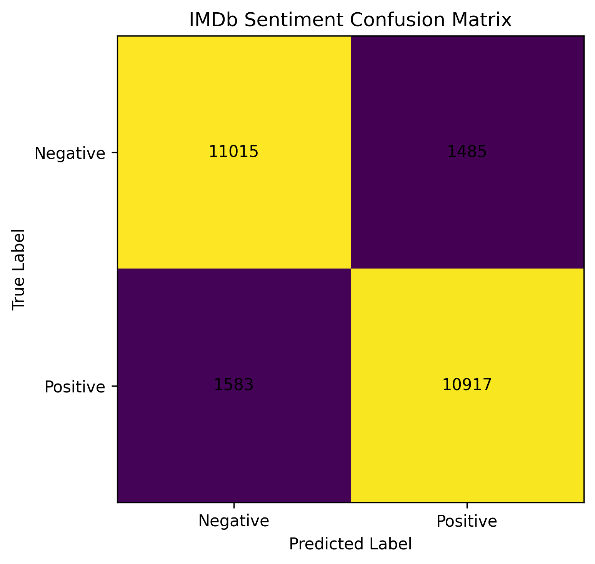

# IMDb Sentiment Analysis with DistilBERT

Fine-tune a transformer to classify English movie reviews as positive or negative, evaluate on a held-out test set, and explore predictions in Streamlit.

**Python · PyTorch · Hugging Face Transformers · IMDb · Streamlit**

[Portfolio](https://github.com/ajmal335) · [Recorded metrics](results/metrics.json) · [Classification report](results/classification_report.txt)

## Recorded results

| Metric | Value |
|---|---:|
| Test accuracy | 87.73% |
| Precision | 88.03% |
| Recall | 87.34% |
| F1 | 87.68% |
| Test reviews | 25,000 |

These numbers are taken from the committed evaluation artifacts. Training and evaluation were not rerun for this documentation update.



## Training approach

- Base model: `distilbert-base-uncased`.
- Labels: `0` negative; `1` positive.
- Training/validation split: 22,500 / 2,500 reviews; separate 25,000-review test split.
- Configuration: maximum sequence length 128, batch size 16, learning rate 2e-5, 2 epochs, seed 42.
- Best validation checkpoint and tokenizer saved to `models/distilbert-imdb`.

See [configuration](src/config.py) and [training implementation](src/train.py) for executable details.

## Run locally

Run from the repository root. GPU training is recommended; the scripts can select CPU when CUDA is unavailable.

```bash
git clone https://github.com/ajmal335/NLP_Sentiment_Analysis.git
cd NLP_Sentiment_Analysis
python -m venv .venv
source .venv/bin/activate
python -m pip install -r requirements.txt
python src/train.py
python src/evaluate.py
python src/predict.py
```

On Windows, activate with `.venv\Scripts\activate`.

**The trained checkpoint is not included in this repository.** Training downloads the base model and IMDb data, then writes the checkpoint locally. Prediction, evaluation, and the UI require that checkpoint first. Do not substitute an unfine-tuned base model and expect the recorded metrics.

```bash
python -m streamlit run app.py
```

## Repository guide

| Path | Responsibility |
|---|---|
| `src/config.py` | Model, training parameters, output paths |
| `src/dataset.py` | Dataset loading and tokenization |
| `src/model.py` | Model creation |
| `src/train.py` | Training, validation, best-checkpoint selection |
| `src/evaluate.py` | Evaluation |
| `src/predict.py` | Interactive text prediction |
| `src/plot_results.py` | Result visualization |
| `app.py` | Streamlit interface |
| `results/` | Committed metrics and plots |

## Learning and limitations

This project demonstrates transformer fine-tuning, validation-driven checkpointing, and classification evaluation. IMDb movie-review accuracy does not establish performance on customer support, Urdu text, sarcasm, or other domains. Softmax output is not calibrated confidence. Long text is truncated during tokenization. This is a portfolio application with a local UI; no public deployment is claimed.

## Next steps

Add error analysis by review length, test inference/training tokenization consistency, evaluate out-of-domain examples, and expose a cached prediction service.
